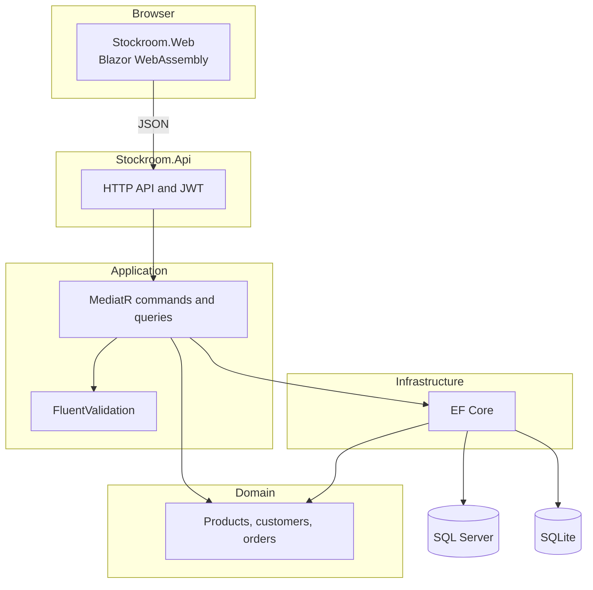

# Stockroom

Portfolio demo of a small inventory and order desk, built by [Arpan Bom](https://github.com/applycoding).

Stockroom is a .NET 8 sample: a JWT-secured ASP.NET Core API in a clean architecture, a Blazor WebAssembly client, and EF Core persistence that runs on SQLite or SQL Server. It is a public demonstration project, not a product. It ships with seeded users, a demo signing key, and a local SQL Server password so a reviewer can run it.

[](https://github.com/applycoding/dotnet-blazor-inventory/actions/workflows/ci.yml)

## Features

- Clean architecture projects: Domain, Application, Infrastructure, and Api, plus a shared Contracts project for the UI
- CQRS with MediatR and FluentValidation, including a validation pipeline
- JWT bearer auth with seeded Admin and Clerk accounts
- Products, stock movements, customers, and orders
- Order flow: draft, submit, fulfill, cancel. Stock is committed when an order is fulfilled
- EF Core migrations for SQL Server and SQLite, applied on startup, with idempotent seed data
- Blazor WebAssembly UI hosted by the API
- xUnit unit tests and integration tests via `WebApplicationFactory`
- Dockerfile and a SQL Server `docker-compose.yml`
- GitHub Actions CI (build, test, and a Docker image build)
- Bicep for Linux App Service and Azure SQL, plus a manual deploy workflow that is not run by CI

## Architecture



| Project | Responsibility |
| --- | --- |
| `Stockroom.Domain` | Entities and invariants. No infrastructure dependencies. |
| `Stockroom.Contracts` | Request and response DTOs shared by the API and the Blazor client. |
| `Stockroom.Application` | Commands, queries, validators, and persistence/auth abstractions. Handlers use an EF-shaped `IStockroomDbContext` so queries stay composable. |
| `Stockroom.Infrastructure` | EF Core, password hashing, JWT creation, migrations, and seed data. |
| `Stockroom.Api` | HTTP host, auth middleware, Swagger, and the published Blazor assets. |
| `Stockroom.Web` | Blazor WebAssembly UI. |

SQLite is the default so `dotnet run` needs no database server. SQL Server uses its own migration set. `DateTimeOffset` values are stored as UTC ticks on SQLite because that provider cannot order by `DateTimeOffset`. Dashboard revenue is totaled in memory for the same reason: the SQLite provider cannot `SUM` decimals.

## Run it

Requires the .NET 8 SDK.

```bash
dotnet run --project src/Stockroom.Api
```

Open http://localhost:5080. Swagger is at http://localhost:5080/swagger. The app creates `src/Stockroom.Api/stockroom.db` and seeds it on startup.

Sign in with either seeded account. The passwords are public on purpose:

| Role | Email | Password |
| --- | --- | --- |
| Admin | `admin@stockroom.demo` | `Demo-Admin-123!` |
| Clerk | `clerk@stockroom.demo` | `Demo-Clerk-123!` |

Both roles can use the demo. The role is a claim on the token; the sample does not add finer authorization.

### SQL Server with Docker

```bash
docker compose up --build
```

The API listens on http://localhost:8080 and applies the SQL Server migrations when the database accepts connections. The `sa` password in `docker-compose.yml` is `Stockroom-demo-9!`. It is a local demo secret, not something to reuse.

To point a local SDK run at SQL Server instead of SQLite:

```bash
DatabaseProvider=SqlServer dotnet run --project src/Stockroom.Api
```

Override `ConnectionStrings__SqlServer` if your instance is not the one in `appsettings.json`.

### Container only, SQLite

```bash
docker build -t stockroom .
docker run --rm -p 8080:8080 stockroom
```

The SQLite file lives in `/app/data` inside the container and disappears when the container does.

## Tests

```bash
dotnet test
```

Unit tests cover order transitions, stock rules, and validators. Integration tests boot the API with `WebApplicationFactory`, use a temporary SQLite file, and walk through login, validation, conflicts, fulfillment, and the seeded dashboard. They do not need SQL Server.

## Azure

`infra/main.bicep` creates a Linux App Service plan (B1), a .NET 8 web app, an Azure SQL server, a Basic database, and a firewall rule that allows Azure services. SQL password and the JWT signing key are secure parameters. The connection string is an app setting named `ConnectionStrings__SqlServer`.

`.github/workflows/deploy-azure.yml` is manual (`workflow_dispatch` only). CI does not deploy. To run it later, create a GitHub environment named `production` and configure OIDC plus these secrets:

- `AZURE_CLIENT_ID`, `AZURE_TENANT_ID`, `AZURE_SUBSCRIPTION_ID`
- `AZURE_RESOURCE_GROUP`
- `SQL_ADMIN_LOGIN`, `SQL_ADMIN_PASSWORD`
- `JWT_SIGNING_KEY` (at least 32 bytes, not the demo key)

Optional variable: `STOCKROOM_APP_NAME` (default `stockroom`).

This repository has not executed that workflow.

```bash
az deployment group create \
  --resource-group <group> \
  --template-file infra/main.bicep \
  --parameters sqlAdminLogin=<login> sqlAdminPassword=<password> jwtSigningKey=<key>
```

## What this leaves out

This is a portfolio slice, not a production system. It does not have refresh tokens, an external identity provider, optimistic concurrency, a locked order-number sequence, or protection against two clerks fulfilling the last unit at the same time. Cancelling a fulfilled order does not return stock. Swagger stays on because reviewers need it. Blazor trimming is off so the JSON models stay reliable. Put secrets in a vault and turn Swagger off before using the shape of this app for anything real.

## License

MIT. Copyright (c) 2026 Arpan Bom. See [LICENSE](LICENSE).
