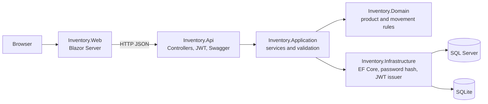

# Northline Inventory

A portfolio demo of a small warehouse ledger: an ASP.NET Core 8 Web API and a Blazor Server UI. Northline Supply is fictional. The seeded login, the signing key in `appsettings.json`, and the SQL password in `docker-compose.yml` are public on purpose. Do not point this at a real warehouse or leave it on the public internet with those defaults.

This repository has not been deployed to a live Azure subscription.

## What it does

- Sign in with JWT bearer tokens.
- Create, edit, search, and archive products. Quantity does not change on the product form.
- Receive stock, issue stock, or set a counted quantity. An issue that would go below zero is rejected.
- Review a dashboard of active SKUs, on-hand value, and items at or under their reorder level.

Archiving a product hides it from the working list and keeps its movement history.

## Architecture



| Project | Role |
| --- | --- |
| `Inventory.Domain` | Entities and stock rules. No framework dependencies. |
| `Inventory.Application` | Use cases, FluentValidation, repository ports. |
| `Inventory.Infrastructure` | EF Core, SQL Server or SQLite, password hashing, JWT issuance, demo seed. |
| `Inventory.Api` | HTTP, Swagger, authentication, ProblemDetails. |
| `Inventory.Web` | Blazor Server client. It talks to the API only. |

The same EF model runs on both databases. Startup calls `EnsureCreated` rather than keeping two sets of provider-specific migrations. That is a demo choice: it builds the schema on an empty database and does not evolve an existing one.

## Run it locally

Requires the .NET 8 SDK.

```bash
dotnet run --project src/Inventory.Api
dotnet run --project src/Inventory.Web
```

- API and Swagger: http://localhost:5080
- UI: http://localhost:5081

Local configuration uses SQLite (`src/Inventory.Api/northline.db`). The file is gitignored.

| | |
| --- | --- |
| Email | `demo@northline.local` |
| Password | `Demo1234!` |

The login screen shows the same account. Six sample products are seeded when the product table is empty, including three that are already under their reorder level.

To use SQL Server instead, set:

```bash
Database__Provider=SqlServer
Database__ConnectionString="Server=localhost,1433;Database=northline;User Id=sa;Password=Northline_Demo123;TrustServerCertificate=True;Encrypt=True"
```

## Tests

```bash
dotnet test NorthlineInventory.sln
```

Domain tests cover stock rules. API tests use `WebApplicationFactory` and a temporary SQLite file: login, validation, conflict on a duplicate SKU, receipts, issues, counts, archive, the dashboard, Swagger, and `/health`.

## Docker Compose

`docker-compose.yml` starts SQL Server 2022, the API, and the Blazor UI. The SQL Server image is built for x64 and wants about 2 GB of RAM. On Apple Silicon, use the SQLite path above instead of this compose file.

```bash
docker compose up --build
```

The compose file uses demo secrets (`Northline_Demo123` and a checked-in JWT signing key). The API retries the database connection while SQL Server starts.

- UI: http://localhost:5081
- API: http://localhost:5080

## Continuous integration

`.github/workflows/ci.yml` restores, builds, and tests on .NET 8, then builds both Docker images. It does not deploy.

## Azure

`infra/main.bicep` is a subscription-scoped template for Azure Developer CLI. It creates a resource group, a Linux App Service plan (B1), two .NET 8 web apps, and a Basic Azure SQL database. `infra/resources.bicep` is the resource-group module and can also be deployed on its own. `azure.yaml` maps the `api` and `web` projects onto those apps with the `azd-service-name` tag.

Basic App Service and Basic SQL are paid SKUs. The template allows Azure services through the SQL firewall and stores the SQL password and JWT key in app settings. A production system would use Key Vault, migrations, and a private password that is not the seeded demo password. `Seed__Enabled` is left on so a reviewer can sign in; the demo password is in this README.

This sample was not deployed while it was written. Example, after `az login`:

```bash
az group create --name rg-northline-demo --location eastus
az deployment group create \
  --resource-group rg-northline-demo \
  --template-file infra/resources.bicep \
  --parameters location=eastus namePrefix=northline1 sqlAdminLogin=northlineadmin \
  --parameters sqlAdminPassword='<a long password>' jwtSigningKey='<at least 32 characters>'

dotnet publish src/Inventory.Api -c Release -o artifacts/api
dotnet publish src/Inventory.Web -c Release -o artifacts/web
az webapp deploy --resource-group rg-northline-demo --name <api-name> --src-path artifacts/api --type directory
az webapp deploy --resource-group rg-northline-demo --name <web-name> --src-path artifacts/web --type directory
```

`namePrefix` should be lowercase letters and numbers. App names have to be globally unique; if `northline1-api` is taken, choose another prefix. The template prints `apiUrl` and `webUrl`.

Azure Developer CLI, from this folder:

```bash
azd env new northline-demo
azd env set SQL_ADMIN_PASSWORD '<a long password>'
azd env set JWT_SIGNING_KEY '<at least 32 characters>'
azd up
```

`azd up` provisions from `infra/main.bicep` and deploys both projects. Confirm after deploy that the API still has `Database__ConnectionString` and the web app still has `Api__BaseUrl`.

## API sketch

| Method | Path | Auth |
| --- | --- | --- |
| `POST` | `/api/auth/login` | anonymous |
| `GET` | `/api/products` | bearer |
| `POST` | `/api/products` | bearer |
| `PUT` | `/api/products/{id}` | bearer |
| `DELETE` | `/api/products/{id}` | bearer, archives |
| `GET` | `/api/stock-movements` | bearer |
| `POST` | `/api/stock-movements` | bearer |
| `GET` | `/api/dashboard` | bearer |
| `GET` | `/health` | anonymous |

Movement `type` is `Receipt`, `Issue`, or `Adjustment`. For a count, `quantity` is the new on-hand total. Failures use ProblemDetails. Not enough stock returns HTTP 422.

## Out of scope

Multi-warehouse stock, barcodes, purchasing, user invites, refresh tokens, row-level security, Key Vault, and a migration history. Optimistic concurrency is present as a token on the product, but the UI does not retry a conflict.
